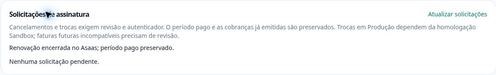

# Cancelamento Sandbox com Master/MFA real — 28/10/2026

Checkpoint de **28/10/2026, 20h11 Manaus** (29/10, 00h11 UTC). O pedido
existente da fixture A foi executado uma vez na sessão Master, após login e
autenticador reais. O Asaas confirmou **INACTIVE**, a auditoria confirmou uma
escrita e o job posterior passou **18/18 verificações reais**.

O cancelamento da parte 5.2 está comprovado. Troca de plano/preço, pagamento e
aplicação na data correta continuam necessários para encerrar esse item;
downgrade/falhas conservam o aceite 5.3. **12/23 (52,17%), 11 restantes,
1/7 etapas encerradas.** Para ultrapassar 60% são necessários 14/23 completos.

## Operação e autorização

O código publicado é o da [PR206](https://github.com/GustavoFboz/dtfipo/pull/206),
merge `d98fe9c77393e77eeb288d5f7bdc497b022a3cd1`. O pedido
`5cd49826-9cec-421d-b511-98519ecdd80e` já existia e não foi recriado.
O login foi realizado no formulário seguro; a área reconheceu o operador e
exigiu um desafio próprio de MFA antes de habilitar a confirmação.
Nenhuma senha, código, token ou cookie foi copiado para o relatório ou usado
para construir claims. Não houve promoção de fixture ou alteração de MFA.

Uma confirmação na UI iniciou uma execução auditada em 00h06m18 UTC; uma
escrita começou às 00h06m18.980669 e terminou confirmada às 00h06m20.316957.
Ambiente Sandbox, sessão real registrada, justificativa presente, resultado
`completed`, erro nulo e prova do provedor com hash
`f0bcbd155462467a836f95f96ec07027`. Não houve repetição nem alteração em Produção.

## Observação independente e preservação

O job `4aa814a2-6e2c-4dfa-90b8-b3898df628d6` executou uma vez, de
00h09m21 a 00h09m27 UTC. Capacidade consumida, cópia local removida, HTTP200
e 18/18 checks. Novas leituras no Asaas verificaram assinatura inativa,
cliente com notificações desativadas e três cobranças com o mesmo hash
anterior. Sessões USER verificadas pelo Auth confirmaram histórico, isolamento
e acesso integral pago. A fase passou de `AWAITING_MASTER` para `COMPLETED`.

| Dado | Antes e depois |
| --- | --- |
| Arquivos prontos / bytes | 701 / 8,374,117,446 |
| Reservas | 0 |
| Storage | `14ddf47d3f3a030d26a698aafc8643d5` |
| Casos | `419b08f5b8905de5caa4fa9616ed4db6` |
| Pacientes | `d1573a1878b4cc6ab9f2d2b3143b3f2d` |
| Pagamentos | `b2c430d6aaed7c02409aca88b4b649ea` |
| Contratos fora das fixtures | `5f93ae8a05622562813e88f6797b522d` |
| Quatro planos e preços | Iguais; digest sanitizado no JSON |
| Ledger A | Dois pagamentos, hash igual ao de antes da ação |
| Cobranças Asaas A | Três, hash igual ao de antes da ação |
| Período pago A | Preservado até 18/12/2026, 00h00 UTC |
| Fixture B | Ativa, plano/preço/vigência e hash preservados |

Snapshots de 00h06m06 e 00h11m18 UTC. Mudaram somente o estado de A para
cancelado, o pedido para concluído e a auditoria de uma execução. Os hashes
de contrato preservam preço, plano, vínculo e período; excluem somente os
campos operacionais descritos no snapshot. Nenhum dado foi excluído, estornado
ou substituído. Os 700 arquivos da rodada anterior são um checkpoint
histórico; esta rodada começou e terminou com 701.

Conexões observadas: 52 antes e 51 depois,
sem espera por locks. Worker Produção `ok`, último heartbeat saudável
00h11m02 UTC. Uma ação Master e um job sequencial, sem retry automático,
mudança de cron ou emissão de cobrança.

## Continuidade

Na UI, a confirmação apareceu corretamente, mas a tabela de empresas ainda
mantinha o snapshot anterior até nova consulta. A correção invalida uma vez
o dashboard da sessão atual após o resultado, sem polling ou repetição
financeira; a regressão de UI confere a atualização do estado.

A fixture B permanece disponível para a troca/downgrade. Antes de solicitar,
conferir cotação normal do gestor, limites, calendário e faturas já emitidas.
Uma fatura futura incompatível ou data divergente exige revisão explícita;
não remover faturas ou alterar vigência para fabricar aceite. O rollout da
nova ação em Produção permanece fechado até a homologação Sandbox.

[Auditoria, recibo e snapshots sanitizados](master-cancellation-20261028.json).
