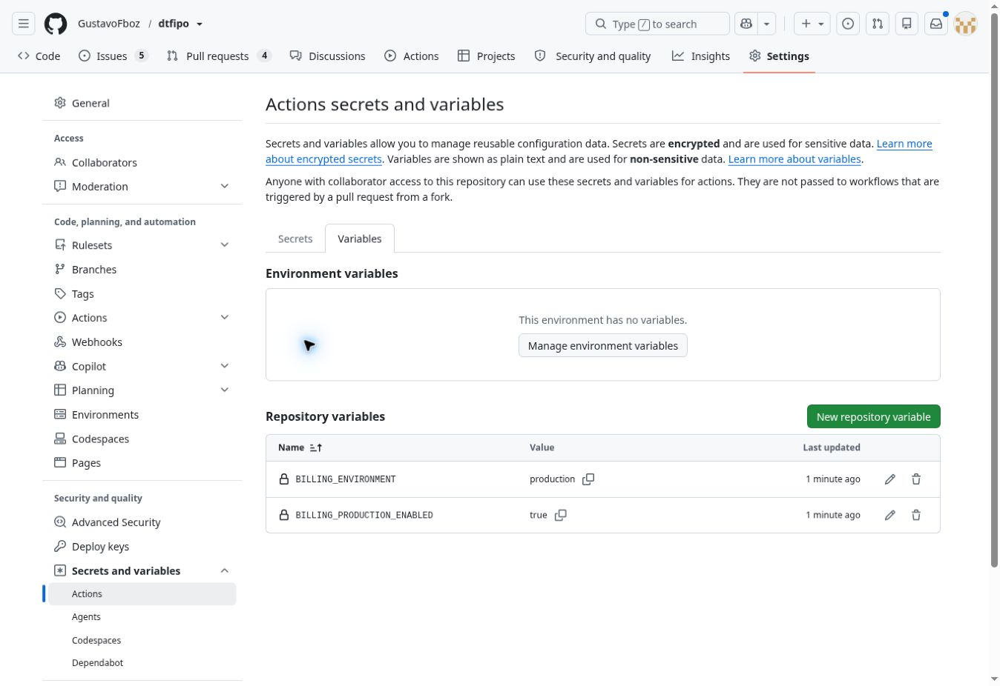

# Ativação técnica de Produção — 18/10/2026

Checkpoint às 16h11 de Manaus (20h11 UTC). O login administrativo do GitHub
foi concluído e a configuração de Produção foi publicada no aplicativo atual.
Este registro comprova configuração e execução; o webhook e o recebimento real
continuam pendentes. **5/23 aceites integrais (21,74%); 0/7 etapas encerradas.**

## Alteração confirmada

| Camada | Resultado |
| --- | --- |
| Backend | `ASAAS_ENVIRONMENT=production`, `ASAAS_PRODUCTION_ENABLED=true` |
| GitHub Variables | `BILLING_ENVIRONMENT=production`, `BILLING_PRODUCTION_ENABLED=true` |
| Cron Produção | Job 2, ativo, `1-59/5 * * * *` |
| Cron Sandbox | Job anterior removido; configuração desativada |
| Plano Inicial | BRL 100 centavos por mês |
| Ledger | Zero pagamentos de Produção; quatro pagamentos Sandbox preservados |

Somente os dois campos conhecidos de ambiente do backend foram substituídos.
Os valores de chaves e tokens não foram lidos, copiados nem regenerados.
As variáveis GitHub foram cadastradas pela interface administrativa oficial.
O código continua pelo GitHub; nenhum prompt ao agente de construção Lovable foi enviado.

A publicação foi solicitada pelo conector para o projeto existente
`a8b717e3-87ad-482d-8d4a-de81679507e0`, deployment
`3fdd46c3-cdcb-49a4-a6be-11b5f16029f3`, em `https://dtfipo.lovable.app`.
A resposta inicial foi pending. A comprovação operacional posterior é o
contrato privado retornando Produção, seguido do registro e das respostas do cron;
o status de provisionamento ready do editor não foi usado como prova de deploy.

## Conferência e troca protegida

A [nova conferência privada](https://github.com/GustavoFboz/dtfipo/actions/runs/39160671286)
executou as duas leituras de Produção com sucesso às 19h51 UTC:
chave válida, aprovação geral APPROVED, dados comerciais e documentação
aprovados, dados bancários PENDING separadamente. Webhook único preparado,
desativado, API 3, sequencial, 13 eventos corretos. O token oculto exige
autenticação por entrega real; não foi regenerado.

O menu de execução manual não apareceu para o bootstrap na branch padrão.
A execução existente da PR168 já contém exatamente o mesmo arquivo protegido
da fonte publicada: blob `a201b26f9e69a11546d73155ebc02ee103cf62df`.
Foi usada sua [segunda tentativa](https://github.com/GustavoFboz/dtfipo/actions/runs/39080225821/attempts/2),
com as variáveis administrativas atuais; debug logging permaneceu desativado.
O job `117775088256` passou e registrou o cron às
`2026-10-18T20:00:47.230114+00:00`.

Antes do POST, o workflow exigiu o contrato privado com ambiente production.
A rota conferiu o isolamento do schema net e copiou internamente o token
exclusivo já existente para o Vault, retirando o job Sandbox.
O operador não precisou fornecer ou recuperar tokens; o workflow usou o secret
já cadastrado. Nenhum destino arbitrário ou comando financeiro imediato foi
solicitado. Nenhuma alteração da main foi necessária.

| Disparo Produção, UTC | Manaus | HTTP | Timeout |
| --- | --- | --- | --- |
| 20:01:00.288150 | 16h01 | 200 | false |
| 20:06:00.387512 | 16h06 | 200 | false |
| 20:11:00.455229 | 16h11 | 200 | false |

A telemetria de 20h11 terminou em status ok; os dez contadores ficaram em zero,
incluindo falhas e revisões. Estes três disparos demonstram a cadência inicial,
sem declarar monitoramento prolongado, alerta real de Produção ou aceite integral 7.2.
[Recibo sanitizado](production-activation-20261018.json).

## Validação de regressão

Passaram 348 testes em 16 arquivos de billing, licença Desktop e expiração
offline. As verificações estáticas das etapas 05, 06 e 09 e o manifesto de
restauração com 175 migrações passaram. Código de produto e workflows não
foram alterados por este checkpoint; a mudança no repositório é documental.

## Pendência para concluir a integração real

O webhook não foi ativado por esta rodada. O login no Asaas avançou até a
verificação SMS. A solicitação segura retornou submission_failed; isso não
comprova código incorreto nem falha de login. A observação seguinte foi negada
pela revisão automática por possível repetição de autenticação sem nova
autorização explícita. Não foi observada mensagem de erro do Asaas, e não houve
tentativa de contornar a restrição.

Após nova autorização, verificar a sessão pelo fluxo permitido, localizar
somente o webhook existente `ee2af07c-ec23-4224-893b-390efbc85c8f`,
ativá-lo e comprovar entrega autenticada. O titular concluirá o checkout oficial
do plano Inicial de R$1/mês em empresa comum elegível; não usar a IPO isenta,
dados fictícios nem recursos Sandbox. Conferir liquidação, ledger e acesso após
a operação. Nenhum pagamento real foi realizado pelo agente.

Não houve migração de hospedagem ou banco, alteração de contratos Sandbox,
replay, cancelamento, estorno, promoção de conta ou nova versão nativa.
Windows/Android, dados remotos e política offline de 72 horas foram preservados.
O item 7.2 permanece parcial e o item 7.3 continua aberto.
