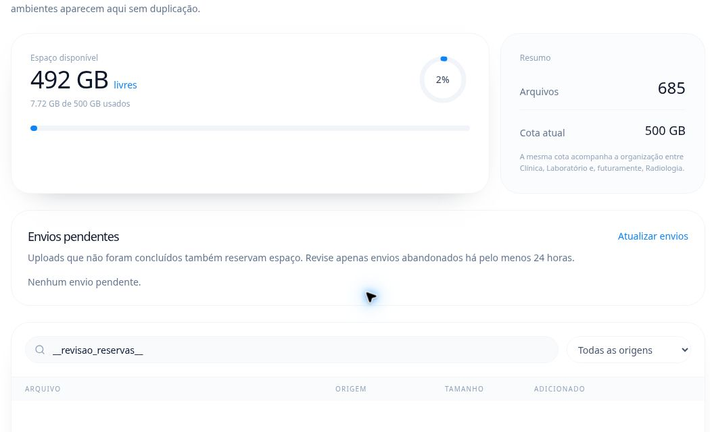

# Liberação autenticada das reservas antigas — 27/10/2026

Às 11h08 de Manaus, a conferência após nove liberações individuais confirmou
zero reservas históricas pendentes e 1.112.944.862 bytes liberados. A sessão
gestora real revisou e confirmou cada envio em `/armazenamento`. Não houve
exclusão direta por SQL nem remoção de objetos clínicos.

Os 685 arquivos prontos e seus 8.291.635.177 bytes permanecem. Os hashes dos
metadados prontos, casos, pacientes e pagamentos são idênticos antes/depois.
A interface confirmou “Nenhum envio pendente”. Com a resiliência comprovada
em 26/10, **o critério 3.2 está concluído: 11/23 (47,83%), 12 restantes,
1/7 etapas encerradas**.

## Requisições limitadas

A PR201 processa um arquivo por vez e interrompe a manutenção ao primeiro
erro; os alvos seguintes ficam intactos para revisão. Passaram 135 testes em
oito arquivos, tipos, build, stage-06, stage-09 e verificação estática do bundle
de 183 migrações. O CI Web passou. As duas tentativas de restauração limpa
pararam no download das imagens, com `toomanyrequests`, antes de aplicar SQL;
não há nova prova de restauração. Nenhuma migração foi alterada nesta entrega.

## Bloqueio independente

O inventário reconfirmou 34 fotos e seis avatares, 1.273.134 bytes. A revisão
automática recusou até a preparação dos jobs por exigir autorização explícita
para retirar os endereços antigos. O SQL rejeitado não foi executado, nenhum
alvo histórico foi preparado e nenhum desses arquivos foi alterado. Não houve
tentativa por outro caminho. A próxima ação requer aprovação específica da
troca de endereço com cópia e hash verificados, preservando arquivos e cotas.

Os ciclos financeiros restantes, a gestão de planos, os aparelhos, a restauração
operacional e a liberação comercial mantêm seus critérios próprios. Nenhuma
cobrança ou assinatura real foi modificada nesta rodada.

[Recibo sanitizado e limites](reservation-release-20261027.json).
